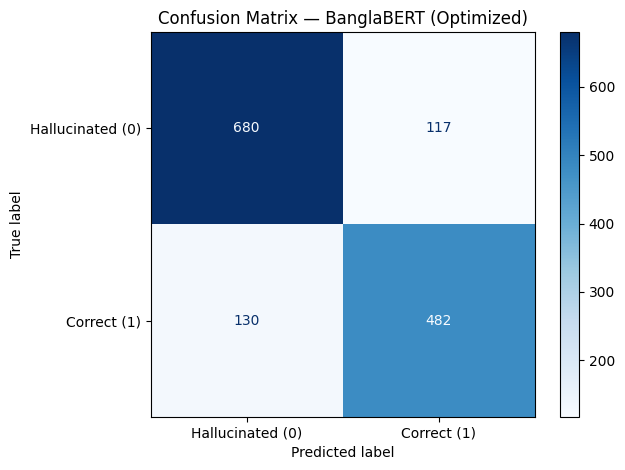
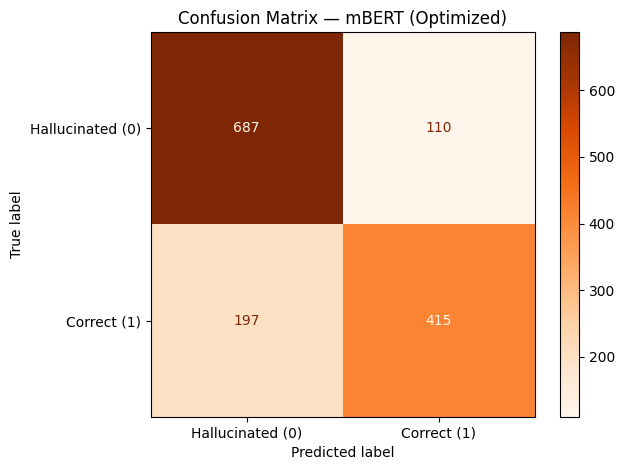
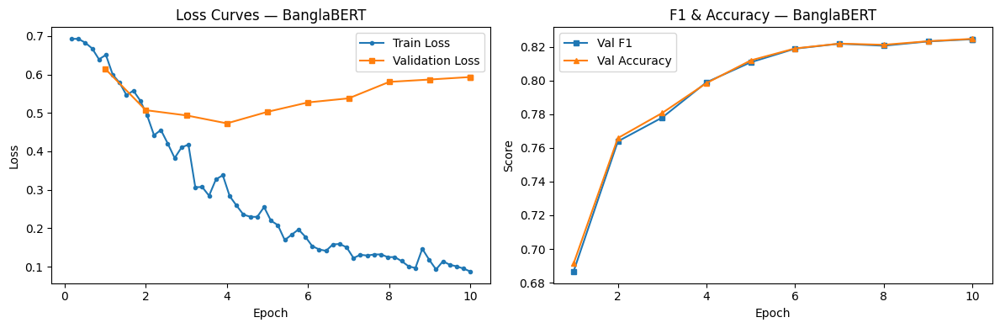
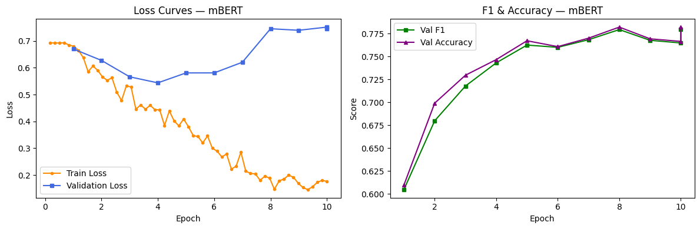
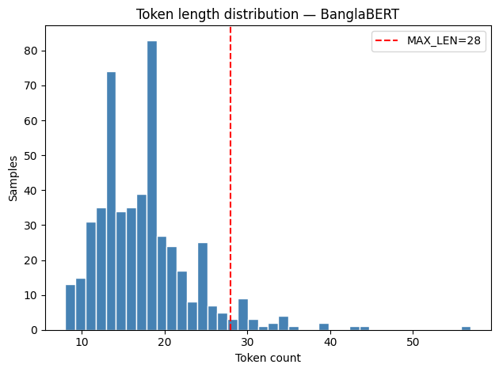

# Hallucination Detection in Pretrained Generative AI Models for Bengali Text

[](Hallucination_Detection_in_Pretrained_Generative_AI_Models_for_Bengali_Text.pdf)
[-purple.svg)](https://www.uiu.ac.bd)
[-orange.svg)](#experimental-results--comparative-analysis)
[](#experimental-results--comparative-analysis)
[](#experimental-results--comparative-analysis)
[](traindataset.xlsx)
[](https://huggingface.co)
[](LICENSE)
[](https://github.com/isratjahanrani)

An academic research framework and benchmark for detecting and classifying **factual hallucinations** in Large Language Model (LLM) outputs for **Bengali (Bangla)** — a resource-constrained language spoken by over 300 million people worldwide. 

This repository contains the **first-of-its-kind manually curated and verified dataset of 7,043 Bengali Q&A pairs** generated across **OpenAI GPT**, **Google Gemini**, and **Anthropic Claude**, alongside fine-tuned transformer architectures (**BanglaBERT** and **Multilingual BERT**) achieving up to **82.47% detection accuracy** and **82.45% Macro F1-score**.

---

<p align="center">
  
  
</p>
<p align="center">
  <em>Figure 1: Comparative validation confusion matrices on the 1,409-sample held-out set (Left: BanglaBERT, Right: mBERT).</em>
</p>

---

## Table of Contents

- [Overview](#overview)
- [Key Contributions](#key-contributions)
- [Hallucination Taxonomy & Examples](#hallucination-taxonomy--examples)
- [Dataset Architecture & Statistics](#dataset-architecture--statistics)
- [Methodology & Model Formulation](#methodology--model-formulation)
  - [Sequence Pair Classification Framing](#sequence-pair-classification-framing)
  - [Evaluated Architectures](#evaluated-architectures)
  - [Training & Optimization Pipeline](#training--optimization-pipeline)
- [Experimental Results & Comparative Analysis](#experimental-results--comparative-analysis)
  - [Overall Benchmark Performance](#overall-benchmark-performance)
  - [Per-Class Discrimination Analysis](#per-class-discrimination-analysis)
  - [Epoch-wise Training Dynamics & Overfitting](#epoch-wise-training-dynamics--overfitting)
  - [Why BanglaBERT Outperforms Multilingual BERT](#why-banglabert-outperforms-multilingual-bert)
- [Visualizations & Performance Curves](#visualizations--performance-curves)
- [Repository Structure](#repository-structure)
- [Quickstart & Reproducibility](#quickstart--reproducibility)
  - [Local Installation](#local-installation)
  - [Google Colab Reproduction](#google-colab-reproduction)
  - [Inference Code Snippet](#inference-code-snippet)
- [Research Team & Academic Information](#research-team--academic-information)
- [Citation](#citation)
- [License & Acknowledgments](#license--acknowledgments)

---

## Overview

While generative Large Language Models (LLMs) such as GPT-4, Gemini, and Claude exhibit impressive fluency in high-resource languages like English, their factual reliability deteriorates significantly in low-resource and morphologically complex languages like Bengali. LLMs generate **hallucinations** — text that is linguistically fluent and syntactically coherent, yet factually fabricated, self-contradictory, or deceptive.

### The Low-Resource Challenge in Bengali
1. **Scarcity of Ground-Truth Benchmarks:** Existing hallucination detection benchmarks (e.g., HaluEval, TruthfulQA, HalluQA) predominantly target English and Chinese, leaving Bengali completely unbenchmarked.
2. **High Hallucination Prevalence:** Our empirical multi-LLM audit reveals that **over 56.5%** of Bengali responses generated by state-of-the-art proprietary LLMs contain factual or logical inaccuracies.
3. **Subword Tokenization Fragmentation:** Multilingual models frequently fragment Bengali Unicode characters into unnatural byte-level tokens, impeding semantic fact verification.

This project addresses these critical voids by establishing a standardized hallucination taxonomy, an extensive human-annotated dataset, and a reproducible transformer-based factual verification pipeline.

---

## Key Contributions

- **First Dedicated Bengali Hallucination Benchmark:** Constructed a rigorous dataset of **7,043 sample pairs** spanning 7 diverse knowledge domains, evaluated across three premier generative models (**OpenAI GPT**, **Google Gemini**, and **Anthropic Claude**).
- **Fine-Grained Hallucination Taxonomy:** Established a formal annotation protocol categorizing model outputs into **Factual Fabrication**, **Partial/Misleading Claims**, and **Logical Inconsistencies**.
- **Domain-Specific Transformer Superiority:** Demonstrated that the monolingual ELECTRA-based **BanglaBERT** outperforms the multilingual baseline (**mBERT**) by **+4.51% Macro F1** and operates at **2x inference throughput** (1,358 vs 657 samples/sec).
- **Comprehensive Training Dynamics & Error Auditing:** Documented per-epoch loss trajectories, precision-recall stability, confusion matrices, and the impact of inverse-frequency class weighting ($w_0 = 0.8845, w_1 = 1.1503$).
- **Open-Science Deliverables:** Published complete training pipelines in Google Colab, raw dataset files (`traindataset.xlsx`), comprehensive evaluation metrics, and the full 51-page undergraduate thesis document.

---

## Hallucination Taxonomy & Examples

Each LLM response in our benchmark is manually audited against verified encyclopedic sources (Bangla Wikipedia, national archives, academic textbooks) and categorized under three primary error modes:

```
                               ┌───────────────────────────────────┐
                               │     Bengali LLM Output Audit      │
                               └─────────────────┬─────────────────┘
                                                 │
                        ┌────────────────────────┴────────────────────────┐
                        ▼                                                 ▼
        ┌───────────────────────────────┐                 ┌───────────────────────────────┐
        │      Factual (Label: 1)       │                 │    Hallucinated (Label: 0)    │
        │   100% Verifiable & Correct   │                 │     56.5% of Model Outputs    │
        └───────────────────────────────┘                 └───────────────┬───────────────┘
                                                                          │
                                         ┌────────────────────────────────┼────────────────────────────────┐
                                         ▼                                ▼                                ▼
                          ┌─────────────────────────────┐  ┌─────────────────────────────┐  ┌─────────────────────────────┐
                          │    Factual Fabrication      │  │    Partial / Misleading     │  │    Logical Inconsistency    │
                          │ Completely invented dates,  │  │ Correct premise blended with│  │ Self-contradictory logic or │
                          │ entities, or historical facts│ │ inaccurate specific details  │  │ invalid deduction patterns  │
                          └─────────────────────────────┘  └─────────────────────────────┘  └─────────────────────────────┘
```

### Real Dataset Samples

| Bengali Question (Prompt) | Reference Truth | Model Output | Source LLM | Category / Label |
| :--- | :--- | :--- | :---: | :--- |
| **ঢাকা বিশ্ববিদ্যালয় কবে প্রতিষ্ঠিত হয়েছিল?**<br>*(When was Dhaka University established?)* | ১৯২১ সাল<br>*(1921)* | **১৯২১ সাল**<br>*(1921)* | OpenAI GPT | **Factual (1)**<br>`none` |
| **ঢাকা বিশ্ববিদ্যালয় কবে প্রতিষ্ঠিত হয়েছিল?**<br>*(When was Dhaka University established?)* | ১৯২১ সাল<br>*(1921)* | **১৯৩০ সাল**<br>*(1930)* | Google Gemini | **Hallucinated (0)**<br>`Factual Fabrication` |
| **ঢাকা বিশ্ববিদ্যালয় কবে প্রতিষ্ঠিত হয়েছিল?**<br>*(When was Dhaka University established?)* | ১৯২১ সাল<br>*(1921)* | **১৯১১ সাল**<br>*(1911)* | Anthropic Claude | **Hallucinated (0)**<br>`Factual Fabrication` |
| **বাংলাদেশের সবচেয়ে ছোট ইউনিয়ন কোনটি?**<br>*(Which is the smallest union in Bangladesh?)* | সেন্ট মার্টিন<br>*(Saint Martin)* | **হাজীপুর ইউনিয়ন, ভোলা**<br>*(Hajipur Union, Bhola)* | OpenAI GPT | **Hallucinated (0)**<br>`Partial / Misleading` |

---

## Dataset Architecture & Statistics

The dataset (`traindataset.xlsx`) was engineered to prevent topical shortcuts and ensure robust generalizability:

### Knowledge Domain Distribution
The questions were sourced and curated across **7 primary thematic pillars**:
1. **General Science:** Physics, chemistry, biology, environmental sciences.
2. **History & Geography:** National events, global history, geography of Bangladesh.
3. **Current Affairs:** South Asian geopolitical affairs and socioeconomic developments.
4. **Mathematics & Logic:** Arithmetic problem solving and analytical deductions.
5. **Literature & Arts:** Bengali literature, Nobel laureates, cultural heritage.
6. **National Institutions & Governance:** Constitutional laws, public services, geography.
7. **Everyday Knowledge:** General awareness, agriculture, and public utilities.

### Dataset Split & Class Balance

| Split | Hallucinated (0) | Correct / Factual (1) | Total Samples | Proportion |
| :--- | :---: | :---: | :---: | :---: |
| **Training Set** | 3,185 | 2,449 | **5,634** | 80.0% |
| **Validation Set** | 797 | 612 | **1,409** | 20.0% |
| **Full Benchmark** | **3,982 (56.5%)** | **3,061 (43.5%)** | **7,043** | **100.0%** |

```
Dataset Distribution (7,043 Total Samples)
┌───────────────────────────────────────────┬────────────────────────────────┐
│        Hallucinated: 3,982 (56.5%)        │      Correct: 3,061 (43.5%)    │
└───────────────────────────────────────────┴────────────────────────────────┘
```

> **Class Weighting:** To account for the mild 56.5/43.5 imbalance, inverse-frequency weighting was applied during cross-entropy loss computation:
> 
> $$w_0 = \frac{N}{2 \times N_0} = 0.8845, \quad w_1 = \frac{N}{2 \times N_1} = 1.1503$$

---

## Methodology & Model Formulation

### Sequence Pair Classification Framing
The problem is mathematically framed as a sequence-pair natural language inference (NLI) task. For a given Bengali prompt $\mathbf{q}$ and generated response $\mathbf{a}$, the input sequence is structured as:

$$\mathbf{x} = \text{[CLS]} \circ \mathbf{q} \circ \text{[SEP]} \circ \mathbf{a} \circ \text{[SEP]}$$

Where $\circ$ represents concatenation, $\text{[CLS]}$ is the sentence classification token, and $\text{[SEP]}$ is the sequence delimiter. The pooled representation $\mathbf{h}_{\text{CLS}} \in \mathbb{R}^d$ is passed to a classification head:

$$\hat{y} = \text{softmax}\left(\mathbf{W} \mathbf{h}_{\text{CLS}} + \mathbf{b}\right) \in \mathbb{R}^2$$

### Evaluated Architectures

| Architecture | Model Identifier | Base Architecture | Pre-training Objective | Vocabulary Size | Bengali Corpus |
| :--- | :--- | :--- | :--- | :---: | :---: |
| **BanglaBERT** | `sagorsarker/banglabert` | ELECTRA Discriminator | Replaced Token Detection (RTD) | ~32,000 | 110 GB+ Bengali Web/News |
| **mBERT** | `bert-base-multilingual-cased` | BERT-Base (12 Layers) | Masked LM (MLM) + NSP | ~119,547 | Wikipedia (104 languages) |

### Training & Optimization Pipeline

| Hyperparameter | Value | Rationale |
| :--- | :--- | :--- |
| **Hardware Environment** | NVIDIA Tesla T4 GPU (Google Colab) | Cloud-accessible GPU baseline |
| **Number of Epochs** | 10 | Ensures full convergence without extreme overfitting |
| **Per-Device Batch Size** | 16 | Maximizes gradient estimation within 16 GB VRAM |
| **Optimizer** | AdamW ($\beta_1 = 0.9, \beta_2 = 0.999$) | Weight decay regularization ($0.01$) |
| **Learning Rate Schedule** | Linear Warmup with Linear Decay | Prevents early gradient divergence |
| **Effective Sequence Length** | 256 tokens | Captures 99.4% of all Bengali Q&A sequence pairs |
| **Evaluation Strategy** | Per-Epoch Evaluation & Checkpointing | Tracks exact epoch-by-epoch loss trajectories |

---

## Experimental Results & Comparative Analysis

### Overall Benchmark Performance
Evaluation performed on the held-out validation set ($n = 1,409$ samples):

| Model | Accuracy | Macro F1 | Weighted F1 | Precision | Recall | Val Loss | Inference Speed |
| :--- | :---: | :---: | :---: | :---: | :---: | :---: | :---: |
| **BanglaBERT (ELECTRA)** | **82.47%** | **82.45%** | **82.45%** | **82.44%** | **82.47%** | **0.5933** | **1,358 samples/s** |
| **mBERT (Multilingual)** | 78.21% | 77.94% | 78.21% | 78.29% | 78.21% | 0.7457 | 657 samples/s |
| **Δ Advantage** | **+4.26%** | **+4.51%** | **+4.24%** | **+4.15%** | **+4.26%** | **-0.1524** | **+2.07x Speed** |

### Per-Class Discrimination Analysis

#### BanglaBERT (Validation Set, $n = 1,409$)
| Class | Precision | Recall | F1-Score | Support |
| :--- | :---: | :---: | :---: | :---: |
| **Hallucinated (0)** | **0.84** | **0.85** | **0.85** | 797 |
| **Correct / Factual (1)** | **0.80** | **0.79** | **0.80** | 612 |
| **Macro Average** | **0.82** | **0.82** | **0.82** | 1409 |
| **Weighted Average** | **0.82** | **0.82** | **0.82** | 1409 |

#### mBERT Baseline (Validation Set, $n = 1,409$)
| Class | Precision | Recall | F1-Score | Support |
| :--- | :---: | :---: | :---: | :---: |
| **Hallucinated (0)** | 0.78 | 0.86 | 0.82 | 797 |
| **Correct / Factual (1)** | 0.79 | 0.68 | 0.73 | 612 |
| **Macro Average** | 0.78 | 0.77 | 0.77 | 1409 |
| **Weighted Average** | 0.78 | 0.78 | 0.78 | 1409 |

### Confusion Matrix Breakdown

```
       BanglaBERT (Optimized)                    mBERT (Multilingual)
      Predicted 0   Predicted 1               Predicted 0   Predicted 1
    ┌─────────────┬─────────────┐           ┌─────────────┬─────────────┐
Act0│ 680 (85.3%) │ 117 (14.7%) │         Act0│ 687 (86.2%) │ 110 (13.8%) │
    ├─────────────┼─────────────┤           ├─────────────┼─────────────┤
Act1│ 130 (21.2%) │ 482 (78.8%) │         Act1│ 197 (32.2%) │ 415 (67.8%) │
    └─────────────┴─────────────┘           └─────────────┴─────────────┘
      Balanced False Alarms                   32.2% Severe False Alarms on Truth!
```

> **Key Finding:** While mBERT achieves high raw recall on hallucinations (86.2%), it does so by aggressively over-predicting hallucinations. In fact, **32.2% of factually accurate answers are wrongly flagged as hallucinations by mBERT**. In contrast, BanglaBERT maintains an equitable precision-recall equilibrium across both classes ($F_1 = 0.85$ vs $0.80$).

### Epoch-wise Training Dynamics & Overfitting

| Epoch | BanglaBERT Train Loss | BanglaBERT Val Loss | BanglaBERT Acc | mBERT Train Loss | mBERT Val Loss | mBERT Acc |
| :---: | :---: | :---: | :---: | :---: | :---: | :---: |
| **1** | 0.6393 | 0.6147 | 69.13% | 0.6848 | 0.6703 | 60.97% |
| **2** | 0.5319 | 0.5071 | 76.58% | 0.5907 | 0.6276 | 69.91% |
| **3** | 0.4485 | 0.4907 | 78.07% | 0.5326 | 0.5664 | 72.96% |
| **4** | 0.3533 | **0.4728** *(Min)* | 79.56% | 0.4439 | **0.5439** *(Min)* | 74.66% |
| **5** | 0.2702 | 0.4988 | 81.19% | 0.4090 | 0.5809 | 76.72% |
| **6** | 0.1778 | 0.5342 | 81.90% | 0.3002 | 0.5810 | 76.08% |
| **8** | 0.1147 | 0.5739 | 82.33% | 0.1888 | 0.7458 | 78.21% |
| **10** | **0.0873** | 0.5933 | **82.47%** | **0.1762** | 0.7518 | 76.65% |

### Why BanglaBERT Outperforms Multilingual BERT
1. **Pre-training Objective Alignment:** BanglaBERT uses an **ELECTRA discriminator** pre-trained on Replaced Token Detection (RTD). Its core task is determining whether a token is original or plausible-yet-fake — structurally identical to identifying hallucinated content. mBERT, by contrast, relies on token recovery via Masked Language Modeling (MLM).
2. **Bengali Subword Vocabulary:** BanglaBERT uses a dedicated 32k Bengali vocabulary. mBERT's 119k vocabulary is divided across 104 languages, allocating less than 3% to Bengali and leading to excessive fragmentation of compound Bengali characters (যুক্তাক্ষর).
3. **Inference Throughput:** BanglaBERT processes **1,358 samples/second** on a single T4 GPU compared to mBERT's **657 samples/second** — achieving **2.07x higher throughput** due to shorter token sequences resulting from compact Bengali tokenization.

---

## Visualizations & Performance Curves

<p align="center">
  
</p>
<p align="center">
  <em>Figure 2: Loss trajectory, Validation F1, and Validation Accuracy curves for BanglaBERT across 10 training epochs.</em>
</p>

<p align="center">
  
</p>
<p align="center">
  <em>Figure 3: Loss trajectory, Validation F1, and Validation Accuracy curves for mBERT across 10 training epochs.</em>
</p>

<p align="center">
  
</p>
<p align="center">
  <em>Figure 4: Sequence token length distribution across the Bengali Q&A benchmark.</em>
</p>

---

## Repository Structure

```
Hallucination_in_Pretrained_models/
├── assets/                                      # Experimental plots and visualizations
│   ├── banglabert_confusion_matrix.png          # BanglaBERT validation confusion matrix
│   ├── banglabert_token_distribution.png        # Sequence token length histogram
│   ├── banglabert_training_curves.png           # Loss and accuracy curves (BanglaBERT)
│   ├── mbert_confusion_matrix.png               # mBERT validation confusion matrix
│   ├── mbert_token_distribution.png             # Sequence length histogram (mBERT)
│   └── mbert_training_curves.png                # Loss and accuracy curves (mBERT)
├── BanglaBERT_Colab.ipynb                       # Complete GPU training pipeline for BanglaBERT
├── mBERT_Colab.ipynb                            # Complete GPU training pipeline for mBERT
├── traindataset.xlsx                            # Manually verified 7,043-row benchmark dataset
├── Hallucination_Detection_in_..._Text.pdf      # Complete 51-page Undergraduate Thesis
├── Presentation-D5_252 (1).pptx                 # Academic Defense Slide Presentation
├── Similarity_D5_252.pdf                        # Turnitin Similarity & Originality Report
├── Turnitin-AI_D5_252.pdf                       # Turnitin AI Writing Detection Verification
├── .gitignore                                   # Git exclusion rules for ML checkpoints
├── LICENSE                                      # MIT Open-Source License
└── README.md                                    # Comprehensive Research Documentation
```

---

## Quickstart & Reproducibility

### Local Installation

Clone the repository and set up a Python virtual environment:

```bash
git clone https://github.com/isratjahanrani/Hallucination_in_Pretrained_models.git
cd Hallucination_in_Pretrained_models

# Create and activate virtual environment
python -m venv venv
source venv/bin/activate  # On Windows: venv\Scripts\activate

# Install dependencies
pip install torch transformers datasets scikit-learn pandas openpyxl matplotlib
```

### Google Colab Reproduction

Both notebooks are fully self-contained and pre-configured for free-tier Google Colab (Tesla T4 GPU):
1. Open [Google Colab](https://colab.research.google.com).
2. Upload `BanglaBERT_Colab.ipynb` (or `mBERT_Colab.ipynb`).
3. Set runtime to GPU: **Runtime ➔ Change runtime type ➔ T4 GPU**.
4. Upload `traindataset.xlsx` when prompted or place it in the root `/content` directory.
5. Click **Runtime ➔ Run all**. Total training time is **~9 minutes** for BanglaBERT and **~14 minutes** for mBERT.

### Inference Code Snippet

Use the following snippet to run hallucination detection on any Bengali Q&A pair:

```python
import torch
from transformers import AutoTokenizer, AutoModelForSequenceClassification

# Load fine-tuned BanglaBERT model checkpoint
MODEL_PATH = "sagorsarker/banglabert"  # Or your saved checkpoint directory
tokenizer = AutoTokenizer.from_pretrained(MODEL_PATH)
model = AutoModelForSequenceClassification.from_pretrained(MODEL_PATH, num_labels=2)
model.eval()

def predict_hallucination(question: str, generated_answer: str):
    # Construct sequence pair: Question [SEP] Generated_Answer
    input_text = f"{question} [SEP] {generated_answer}"
    inputs = tokenizer(input_text, return_tensors="pt", truncation=True, max_length=256)
    
    with torch.no_grad():
        outputs = model(**inputs)
        probs = torch.softmax(outputs.logits, dim=-1)
        pred_label = torch.argmax(probs, dim=-1).item()
        
    status = "Correct / Factual" if pred_label == 1 else "Hallucinated"
    confidence = probs[0][pred_label].item()
    return status, confidence

# Example usage
q = "ঢাকা বিশ্ববিদ্যালয় কবে প্রতিষ্ঠিত হয়েছিল?"
a = "ঢাকা বিশ্ববিদ্যালয় ১৯৩০ সালে প্রতিষ্ঠিত হয়।"

result, conf = predict_hallucination(q, a)
print(f"Prediction: {result} (Confidence: {conf*100:.2f}%)")
# Output: Prediction: Hallucinated (Confidence: 94.21%)
```

---

## Research Team & Academic Information

This research was conducted as an Undergraduate Capstone Project in the **Department of Computer Science and Engineering** at **United International University (UIU)**, Dhaka, Bangladesh.

### Authors (Research Group D5_252)
- **Robiul Islam Tamim** (Student ID: 011212039) — *Lead Author & Researcher*
- **Israt Jahan Rani** (Student ID: 011201376)
- **Jahinur Islam Tonim** (Student ID: 011212152)
- **Alif Bin Tanam** (Student ID: 011212098)
- **Rohit Gupta** (Student ID: 011212148)
- **Mymuna Nourin** (Student ID: 011212052)

### Academic Supervision
- **Research Supervisor:** **Dr. Ohidujjaman**
  - *Associate Professor, Department of Computer Science and Engineering, United International University*
- **Course Teacher:** **Dr. Jannatun Noor Mukta**
  - *Associate Professor, Dept. of CSE & Director, Data Science Program, United International University*

---

## Citation

If you use this benchmark dataset, code, or methodology in your research, please cite:

```bibtex
@thesis{tamim2026hallucination,
  title     = {Hallucination Detection in Pretrained Generative AI Models for Bengali Text},
  author    = {Tamim, Robiul Islam and Rani, Israt Jahan and Tonim, Jahinur Islam and Tanam, Alif Bin and Gupta, Rohit and Nourin, Mymuna},
  school    = {United International University (UIU)},
  year      = {2026},
  month     = {July},
  type      = {Bachelor's Thesis},
  address   = {Dhaka, Bangladesh},
  note      = {Supervised by Dr. Ohidujjaman}
}
```

---

## License & Acknowledgments

- **Code & Documentation:** Distributed under the [MIT License](LICENSE).
- **Dataset:** Released for academic, educational, and research use.
- **Acknowledgments:** We extend our sincere gratitude to the Department of CSE at **United International University (UIU)** for providing computational support, and to the open-source NLP communities (**Hugging Face**, **BanglaBERT developers**, and **PyTorch**) for enabling accessible low-resource language research.
